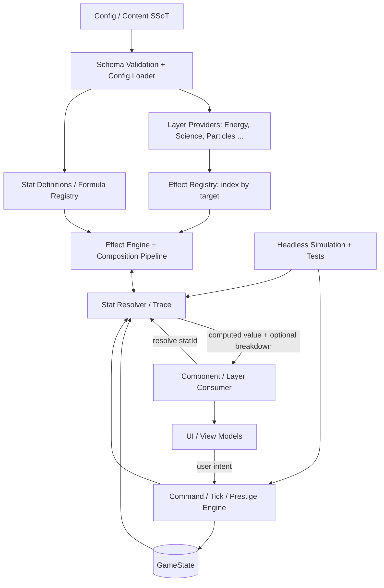
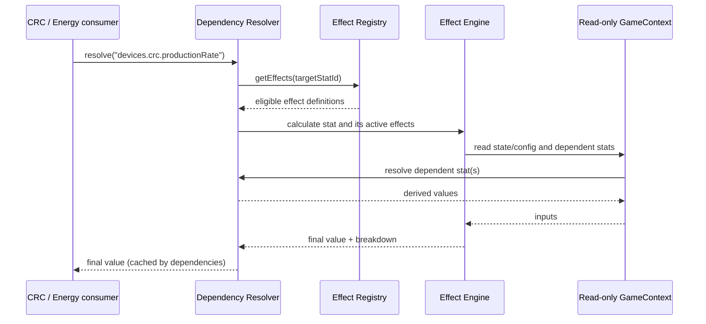
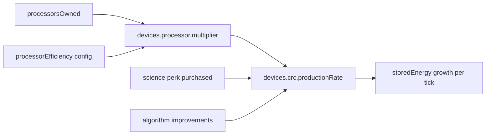

# The Eternal Simulation — Architecture Blueprint

> **Status:** arquitetura de referência (v1.2, implementação incremental em andamento)  
> **Público:** contributors, mantenedores e agentes de programação  
> **Objetivo:** suportar crescimento de eras, dispositivos, estudos, perks e fórmulas sem criar uma teia de imports entre Layers nem duplicar regras matemáticas.  
> **Idioma de referência:** português; identificadores de código em inglês.

## 0. Decisões executivas

1. **SSoT configurável:** definições de conteúdo, parâmetros, IDs, dependências, prioridades e referências de fórmulas são carregadas de configuração validada e versionada (JSON ou equivalente). O progresso do jogador pertence a um `GameState` separado.
2. **Layers como fontes de efeitos:** `Energy`, `Science`, `Particles` etc. organizam conteúdo e expõem pacotes de **definições de efeitos**, sem chamar diretamente outras Layers.
3. **Distribuição centralizada:** `EffectRegistry` indexa efeitos por `targetStatId`. A `EffectEngine` resolve sob demanda os efeitos relevantes quando um componente solicita seu próprio atributo. A Engine **não** contém um `switch` com todos os destinos do jogo.
4. **Consumo por atributo:** o CRC solicita `devices.crc.productionRate`; não precisa saber se o bônus vem da Science Era, de partículas ou de uma futura Layer.
5. **Seis aliases de efeito:** `mult`, `expps`, `logg`, `mults`, `expps_step`, `loggs` são definidos como nomes distintos, com semântica rigorosa descrita abaixo. No motor, operações e escalonamento por steps são **dimensões separadas**.
6. **Concatenação determinística:** política de composição declarada por atributo, executada por uma Engine compartilhada. A Layer consumidora pode solicitar um pipeline, mas não reimplementar as operações.
7. **Resolver antes de cache:** resolução por ID, dependências, detecção de ciclos e trace entram na fundação. Cache seletivo é um módulo opcional, introduzido somente após profiling e nunca tratado como fonte de verdade.
8. **Transações separadas dos efeitos puros:** compras, ticks, prestige, automações, preservações de reset e desbloqueios são comandos/eventos que alteram estado. Efeitos aritméticos apenas derivam valores.
9. **Engine independente da UI:** mesma lógica para o jogo interativo, testes, depuração e simulações rápidas de progressão.
10. **Compatibilidade evolutiva:** preservar código e saves existentes por meio de migrações incrementais; não iniciar uma reescrita total sem auditoria do repositório.
11. **Números gigantes como infraestrutura:** `break_eternity.js` é a implementação escolhida para `BigNum`, isolada por um adaptador próprio. Quantidades econômicas ilimitadas nunca usam `Number` nativo nem são persistidas como números JSON.
12. **Reuso por composição:** runtime compartilhável, `GamePackage` declarativo, estado de partida separado e behavior plugins. Não criar subclasses por conteúdo nem extrair um framework antes de um segundo jogo validar os contratos.

### O princípio arquitetural

> **Config define o que existe. GameState define o que o jogador possui. Layers agrupam conteúdo. Registry localiza modificadores. EffectEngine resolve valores. Commands alteram o estado. UI apenas apresenta e solicita ações.**

---

## 1. Mapa do sistema



A conexão lógica é **N:N**: qualquer Layer pode publicar efeitos para qualquer atributo; qualquer atributo pode receber efeitos de muitas Layers. O relacionamento é mediado por **IDs e contratos**, não por referências diretas entre instâncias das Layers.

### Fluxo de um cálculo



---

## 2. Contratos e responsabilidades

| Elemento | Responsabilidade | Não deve fazer |
|---|---|---|
| `ConfigLoader` | Carregar, validar, versionar e disponibilizar definições imutáveis | Guardar progresso do jogador |
| `GameState` | Estado persistente: quantidades, recursos, perks, discoveries, timestamps | Duplicar valores derivados |
| `LayerProvider` | Organizar conteúdo e declarar os efeitos de sua era | Importar ou manipular diretamente outras Layers |
| `EffectRegistry` | Indexar definições de efeitos por `targetStatId` | Calcular efeitos ou mutar GameState |
| `FormulaRegistry` | Implementar fórmulas puras por `formulaId` | Comprar dispositivos ou executar prestiges |
| `EffectEngine` | Avaliar expressões, filtrar ativação, compor operações e gerar breakdown | Hardcodar a lista de todos os perks ou seus destinos |
| `StatResolver` | Resolver stats relacionadas, detectar ciclos e produzir trace | Mutar estado ou assumir valores de snapshots antigos |
| `DerivedCache` | Opcionalmente reutilizar resultados caros por snapshot/revision | Virar fonte de verdade ou existir sem ganho medido |
| `NumericAdapter` | Centralizar BigNum, comparação, persistência e notação | Expor `Decimal` por todo o domínio |
| `CommandEngine` | Validar e aplicar transições atômicas de estado | Calcular diretamente bônus específicos de perks |
| `SimulationRunner` | Executar estratégias/ticks sem UI com a mesma engine | Implementar regras de jogo paralelas |
| `UI` | Renderizar view models e enviar comandos | Reimplementar fórmulas de produção ou de custos |

**Classes por Layer:** são apropriadas para ciclo de vida (`onEnter`, `onPrestige`), agrupamento e integração. Não precisam existir classes individuais para cada perk ou dispositivo; prefira definições declarativas e funções puras. Reserve classes especializadas para comportamentos com identidade/ciclo de vida reais.

---

## 3. SSoT: configuração ≠ estado ≠ cálculo

### 3.1. Três categorias de informação

- **Configuração imutável por versão:** `processor.baseEfficiency = 1.15`; custo de perks; fórmulas por ID; targets; ordem de composição; condições de revelação; textos de UI. É a **SSoT de regras**.
- **Estado mutável do jogador:** `processorsOwned = 14`; `sciencePointsAllocated = 3`; `totalQuarksEarned`; `storedEnergy`; perks comprados. É a **SSoT da partida**.
- **Valores derivados:** `processor.multiplier`, `devices.crc.productionRate`, tempo de pesquisa etc. Não são persistidos como verdade; são recalculáveis, com cache descartável.

> **Importante:** um `config.json` impede duplicação de parâmetros, mas **não substitui** dependências e invalidação de cache. Um resultado calculado ontem com a mesma configuração pode ficar obsoleto quando o jogador compra um Processor hoje.

### 3.2. Conteúdo configurável e fórmulas

O JSON deve armazenar **parâmetros e IDs de fórmulas registradas**, não trechos JavaScript arbitrários executados com `eval`/`new Function`.

- Alteração de coeficiente ou regra declarativa: modificar configuração.
- Alteração de equação matemática compartilhada: modificar a função pura correspondente no `FormulaRegistry`.
- Alteração da semântica global de concatenação: modificar a `EffectEngine` e atualizar testes.

Isso mantém o código auditável, testável e seguro para contribuições de terceiros.

### 3.3. Exemplo ilustrativo de configuração

```json
{
  "schemaVersion": 1,
  "numbers": {
    "processorBaseEfficiency": "1.15",
    "crcBaseJoulesPerSecond": "1e-12",
    "scienceProcessorCrcExponent": "0.15",
    "quantumSpeedPerImprovement": "0.003"
  },
  "stats": {
    "devices.processor.multiplier": {
      "formulaId": "processorMultiplier",
      "unit": "multiplier"
    },
    "devices.crc.productionRate": {
      "formulaId": "crcBaseProduction",
      "unit": "J/s",
      "pipeline": ["add", "mult", "expps", "logg", "softcap", "hardcap"]
    },
    "studies.algorithmImprovement.speed": {
      "formulaId": "algorithmImprovementBaseSpeed",
      "unit": "speedMultiplier",
      "pipeline": ["add", "mult", "expps", "logg", "softcap", "hardcap"]
    }
  },
  "effects": [
    {
      "id": "science.processorBonusToCrc",
      "sourceLayer": "science",
      "targetStatId": "devices.crc.productionRate",
      "type": "mult",
      "value": {
        "formulaId": "power",
        "args": [
          { "stat": "devices.processor.multiplier" },
          { "config": "numbers.scienceProcessorCrcExponent" }
        ]
      },
      "enabledWhen": { "perkPurchased": "science.processorBonusToCrc" }
    },
    {
      "id": "science.speedPerImprovement",
      "sourceLayer": "science",
      "targetStatId": "studies.algorithmImprovement.speed",
      "type": "mults",
      "perStepRate": { "config": "numbers.quantumSpeedPerImprovement" },
      "steps": { "state": "studies.algorithmImprovementsOwned" },
      "enabledWhen": { "perkPurchased": "science.speedPerImprovement" }
    }
  ]
}
```

Esse exemplo **não afirma que esses perks específicos já existem**; serve apenas para mostrar o contrato e o uso de seus tipos de efeito. As IDs de conteúdo reais devem vir do repositório existente e ser normalizadas em uma migração controlada.

### 3.4. Validação obrigatória

- IDs únicos e estáveis; `targetStatId` declarado; `formulaId` registrado.
- Unidades compatíveis (J, J/s, segundos, multiplicador, contagem, booleano).
- Parâmetros exigidos por cada operação presentes e válidos.
- Bases logarítmicas positivas e diferentes de 1; argumentos no domínio válido.
- Exponentes, thresholds, steps e limites com intervalo coerente.
- Referências de perks, entidades e dependências existentes.
- Sem referências cíclicas no grafo **estático** conhecido; ciclos dinâmicos detectados durante resolução.
- Nenhum parâmetro de grande número convertido silenciosamente para `Number` comum.
- Schema versionado e migrações para alterações incompatíveis.

---

## 4. Tipos de efeitos e semântica matemática

### 4.1. Os seis tipos propostos

**Normalização de nomenclatura (pendente de confirmação):** no rascunho, `expps` foi usado para ambos os casos (direto e por step). Como um mesmo identificador não pode representar duas semânticas diferentes, este documento reserva `expps` para o efeito direto e propõe `expps_step` para o efeito por evolução. Os nomes podem ser renomeados antes da implementação; a distinção funcional é obrigatória.

| Alias de conteúdo | Operação base | Semântica direta | Semântica com steps |
|---|---|---|---|
| `mult` | multiplicação | `value <- value * factor` | — |
| `expps` | potência | `value <- value ^ exponent` | — |
| `logg` | logaritmo | `value <- log_base(value)` **ou expressão fonte explícita** | — |
| `mults` | multiplicação por steps | — | por padrão `value <- value * (1 + rate)^steps` |
| `expps_step` | potência por steps | — | composição repetida de potência: `value <- value^(exponent^steps)` |
| `loggs` | logaritmo por steps | — | composição repetida de `log_base`, **somente quando domínio e limite de iterações forem seguros** |

**Terminologia:** `steps` = quantidade de evoluções/purchases/ciclos especificada por `stepSource`; **não** significa número de ticks por segundo. Exemplo: um bônus de **+0,3% a cada A. Improvement** equivale, com capitalização composta, a `factor = (1.003)^improvementsOwned`, e não a multiplicar por `0.003`.

### 4.2. Ressalva importante sobre `expps` e `loggs`

Aplicar `expps_step` sucessivamente a um valor pode explodir: após `n` aplicações de `value -> value^p`, obtém-se `value^(p^n)`. Isso **não equivale** a somar expoentes nem a multiplicar `p*n`.

Da mesma forma, aplicar log repetidamente pode produzir valores menores ou iguais a zero e tornar a próxima iteração inválida. **Não inferir automaticamente** que `loggs` significa `log(1 + steps)`: são operações diferentes.

A implementação deve suportar os aliases, mas exigir a política explícita `stepSemantics`:

- `compoundRate` para `mults`: `(1 + rate)^steps`.
- `repeatTransform` para `expps_step` e `loggs`: a mesma transformação repetida `steps` vezes, se matematicamente válida e computacionalmente viável.
- `customFormula` quando o objetivo for, por exemplo, `1 + k*log_b(1+steps)` ou `base^(k*steps)`. Nesses casos, chamar uma fórmula registrada e usá-la como **fator** ou **expoente**; não alterar escondido a definição do operador.

**Regra de performance:** evitar loops de `steps` iterações quando a contagem pode chegar a milhões. Usar forma fechada, algoritmo eficiente, ou rejeitar uma definição sem estratégia de cálculo seguro. `loggs` genérico pode requerer limite de iterações e validação de domínio a cada passo.

### 4.3. Tipos que eu adicionaria

| Tipo | Por quê | Exemplo |
|---|---|---|
| `add` | Bônus absoluto sem percentual | `+3 J/s` |
| `adds` | Bônus absoluto por step | `+0,2 J/s por CRC` |
| `softcap` | Compressão de ganho acima de limiar | bônus quântico cresce mais devagar após `1.15x` |
| `hardcap` / `floor` | Limite superior/inferior | bônus máximo de `1.30x` |
| `override` | Substituição condicional, com prioridade declarada | alterar regra de capacidade num marco futuro |

**Não misturar no mesmo mecanismo:** `unlock`, `purchase`, `resourceTransfer`, `prestige`, `preserveOnReset`, `spawn` e modificações booleanas de estado são **regras/comandos/event hooks**, não operadores aritméticos. Ex.: *Quantum Superposition* pode fornecer uma **fração de retenção derivada** via EffectEngine; a aplicação da retenção acontece na transação de `AlgorithmUpgrade`.

### 4.4. Dimensões normalizadas no núcleo

Manter os nomes amigáveis no conteúdo, mas normalizar internamente:

```typescript
type Operation =
  | "add" | "multiply" | "power" | "log"
  | "softcap" | "hardcap" | "floor" | "override";

type StepMode = "none" | "compoundRate" | "repeatTransform" | "customFormula";

type NormalizedEffect = {
  id: string;
  targetStatId: string;
  operation: Operation;
  stepMode: StepMode;
  sourceLayer: string;
  priority: number;
  valueExpression?: Expression;
  stepSource?: Expression;
  enabledWhen?: Condition;
};
```

Os seis aliases são **açúcar sintático**, não seis algoritmos inteiramente desconectados. Isso facilita criar outros efeitos sem aumentar a quantidade de classes.

---

## 5. Composição e distribuição de efeitos

### 5.1. Quem controla o quê

- **Layer/Config:** define a origem, o destino, os parâmetros e a condição de ativação de cada efeito.
- **EffectRegistry:** distribui/indexa: `targetStatId -> effects[]` (sem reimplementação nas Layers consumidoras).
- **EffectEngine:** ordena e executa a pipeline do atributo, resolvendo argumentos e registrando breakdown.
- **Consumer:** solicita um atributo final (`resolve("devices.crc.productionRate")`) e usa o valor. Não identifica manualmente todas as fontes de efeitos.

**Resposta à proposta de centralização:** sim, a distribuição é centralizada; **não** é necessário escrever dentro da classe `EffectEngine` uma lista hardcoded dizendo qual perk vai para qual objeto. Essa associação deve nascer da SSoT e do Registry.

### 5.2. Ordem de aplicação

Padrão sugerido para stats numéricas, **substituível por atributo**:

1. `baseFormula`.
2. `add` e `adds`.
3. `mult` e `mults`.
4. `expps` e `expps_step`.
5. `logg` e `loggs` **somente quando explicitamente configurados para transformar o acumulador**.
6. `softcap`, `hardcap`, `floor`.
7. `override` condicionado com precedência explicitamente documentada; quando usado, prevalece sobre as fases definidas para aquele alvo.

Dentro de uma mesma fase, usar prioridade explícita seguida de `effectId` como desempate determinístico. **Cuidado:** potências, logs e overrides não são comutativos; não presumir que toda sequência pode ser reordenada.

**Recomendação forte:** um efeito como `ProcessorMultiplier^0.15` normalmente é uma **expressão que produz o fator de um `mult`**, não uma potência aplicada sobre a produção inteira do CRC. A pipeline deve distinguir `expression -> factor` de `operation on accumulated result`.

### 5.3. Breakdown obrigatório em debug

Todo `resolve(statId, { trace: true })` pode retornar:

```json
{
  "statId": "devices.crc.productionRate",
  "base": "1e-12",
  "contributions": [
    { "effectId": "energy.improvements", "operation": "mult", "factor": "1000" },
    { "effectId": "science.processorBonusToCrc", "operation": "mult", "factor": "1.25" }
  ],
  "final": "1.25e-9",
  "unit": "J/s"
}
```

Breakdown deve ser derivado pela engine, não mantido manualmente pela UI. Pode incluir referências das dependências, cache hits e eventuais softcaps para diagnóstico.

---

## 6. API de referência (TypeScript ilustrativo)

> O contrato abaixo é **conceitual** e independente de framework. Adaptar aos tipos, bibliotecas e convenções reais do repositório.

```typescript
interface ReadOnlyGameContext {
  readonly state: Readonly<GameState>;
  readonly config: Readonly<GameConfig>;
  stat(id: string): BigNum;
  hasPerk(id: string): boolean;
}

interface EffectProvider {
  readonly layerId: string;
  getDefinitions(): readonly EffectDefinition[];
}

interface EffectResolver {
  resolve(statId: string): BigNum;
  explain(statId: string): StatBreakdown;
}

class EnergyLayer {
  constructor(private readonly effects: EffectResolver) {}

  getCrcProductionRate(): BigNum {
    return this.effects.resolve("devices.crc.productionRate");
  }
}
```

`BigNum` representa a abstração de números grandes do projeto. Sua implementação inicial é `Decimal`, de `break_eternity.js`, escondida atrás do módulo `core/numeric`. As fórmulas não devem importar a biblioteca diretamente; valores da configuração são lidos como strings decimais/exponenciais quando necessário.

### 6.1. Registro genérico, sem imports cruzados

```typescript
const providers: EffectProvider[] = [energyProvider, scienceProvider, particlesProvider];
const definitions = providers.flatMap(p => p.getDefinitions());

const registry = EffectRegistry.fromDefinitions(definitions);
const resolver = new DependencyResolver({ registry, formulaRegistry, state, config });

const crc = new EnergyLayer(resolver);
const productionRate = crc.getCrcProductionRate();
```

O código consumidor não precisa importar `ScienceLayer` nem `ParticlesLayer`. O processo de bootstrap faz a composição das fontes.

### 6.2. Contrato mínimo de uma fórmula

```typescript
type FormulaHandler = (
  ctx: ReadOnlyGameContext,
  args: Readonly<Record<string, BigNum>>
) => BigNum;

interface FormulaRegistry {
  register(id: string, handler: FormulaHandler): void;
  evaluate(id: string, ctx: ReadOnlyGameContext, args: Record<string, BigNum>): BigNum;
}
```

Todas as fórmulas devem ser **puras**: sem mutações de GameState, sem chamadas de UI, sem relógio global, sem efeitos colaterais e sem valores aleatórios não controlados. Para aleatoriedade, passar RNG determinístico/semente no contexto apropriado.

---

## 7. Resolução e dependências primeiro; cache sob demanda

**Decisão:** implementar resolução por ID, dependências explícitas/detectadas, trace e diagnóstico de ciclos desde a fundação. Invalidação seletiva e cache entram somente quando profiling demonstrar custo relevante.

### 7.1. Exemplo de dependências



### 7.2. Comportamento obrigatório

1. Durante `resolve(statId)`, registrar quais chaves de estado/config e quais outras stats foram lidas.
2. Construir arestas `dependency -> dependent` dinamicamente ou a partir de declarações estáticas validadas.
3. Recalcular a partir do snapshot corrente e nunca persistir derived state como verdade.
4. Quando houver cache medido, vinculá-lo à revision do snapshot e invalidá-lo de modo verificável.
5. Detectar ciclo no momento da resolução, emitindo erro diagnóstico com caminho completo (`A -> B -> C -> A`).
6. Quando uma condição de ativação mudar (perk comprado, descoberta revelada), invalidar os targets afetados.
7. Ao trocar versão da configuração, invalidar ou recriar caches afetados; jamais reutilizar cálculos de uma versão anterior indiscriminadamente.
8. Durante uma transação de tick/compra/prestige, trabalhar com **snapshot consistente** e só publicar o novo estado após commit.

### 7.3. Política prática de cache opcional

- Cache por `statId` **e escopo/entidade** (se houver instâncias: `crc:7`, `assemblyUnit:2`) mais chave de parâmetros.
- Associar resultados a versões ou revisions de dependências e à versão da config.
- Começar sem cache seletivo; preferir fórmulas fechadas e evitar recalcular apenas onde profiling apontar impacto material.
- Não calcular duas vezes uma stat cara no mesmo snapshot depois que o cache for introduzido.
- Diferenciar **simulação/tick** de **renderização**; a UI pode ler dezenas de vezes os mesmos valores sem forçar recálculos.
- Instrumentar `cacheHit`, `cacheMiss`, `calculationTime`, `invalidatedStats` em ambiente de desenvolvimento.
- Documentar quando uma fórmula é deliberadamente **não cacheável** (depende de tempo/estado que varia continuamente) e injetar esse tempo explicitamente.

**Evitar:** cache global de pacotes JSON com valores já resolvidos que outras Layers continuam consumindo depois de estado alterado. Pacotes exportados devem ser essencialmente **definições**; resultados pertencem ao resolver/cache versionado.

### 7.4. Testes indispensáveis para o grafo

- Se `processorEfficiency` muda, `processor.multiplier` e `crc.productionRate` são recalculados.
- Se `processorsOwned` muda, apenas dependentes são invalidados.
- Se uma condição de perk muda, o efeito entra/sai do resultado corretamente.
- Resultado após invalidação é igual ao cálculo completo sem cache.
- Ciclos são detectados com diagnóstico útil.
- Valor nunca fica obsoleto após prestige, reload de configuração ou migração de save.

---

## 8. Números gigantes e precisão

A Science Era evolui até `100e60 J = 1e62 J` e depois envolverá expoentes muito maiores. A implementação atual com `Number` nativo falha em aproximadamente `1.797693e308`: operações passam a retornar `Infinity`, a UI mostra `SIGNAL ERROR` e a serialização JSON converte valores não finitos em `null`. Essa limitação afeta cálculo, simulação e save; não pode ser resolvida apenas por um formatter.

### 8.1. Decisão numérica

Adotar `break_eternity.js` como implementação de `BigNum`. A biblioteca representa números por sinal, camada exponencial e magnitude, permitindo valores como `1e384051168456` e escalas com múltiplas camadas exponenciais sem materializar o inteiro completo. Essa escolha é adequada ao crescimento de um incremental e oferece margem para as Eras futuras.

Não expor `Decimal` como dependência transversal. Criar um módulo profundo `core/numeric` com interface pequena e implementação centralizada:

```typescript
type BigNumInput = BigNum | string | number;

interface NumericAdapter {
  from(value: BigNumInput): BigNum;
  add(a: BigNumInput, b: BigNumInput): BigNum;
  sub(a: BigNumInput, b: BigNumInput): BigNum;
  mul(a: BigNumInput, b: BigNumInput): BigNum;
  div(a: BigNumInput, b: BigNumInput): BigNum;
  pow(base: BigNumInput, exponent: BigNumInput): BigNum;
  log10(value: BigNumInput): BigNum;
  compare(a: BigNumInput, b: BigNumInput): -1 | 0 | 1;
  min(a: BigNumInput, b: BigNumInput): BigNum;
  max(a: BigNumInput, b: BigNumInput): BigNum;
  serialize(value: BigNumInput): string;
  deserialize(value: string): BigNum;
}
```

O adapter também expõe constantes (`ZERO`, `ONE`) e predicados de domínio. Callers usam as operações do adapter ou métodos definidos pelo alias `BigNum`; não convertem quantidades econômicas para `Number` como etapa intermediária.

### 8.2. Quais valores usam BigNum

Usar `BigNum` para toda quantidade que pode crescer, diminuir ou participar de fórmulas econômicas sem limite de design conhecido:

- energia armazenada, pico, produção, decay, custos e capacidade;
- multiplicadores de Improvements, Upgrades, Processors e efeitos de perks;
- Science Points, quarks e totais históricos quando puderem escalar indefinidamente;
- contagens usadas como expoentes ou que possam ultrapassar `Number.MAX_SAFE_INTEGER`.

Continuar usando `Number` para tempo de parede limitado (`deltaTime`, milissegundos de renderização), índices de arrays pequenos e contagens comprovadamente limitadas. Duração/progresso de trabalho que possa ficar astronomicamente pequeno ou rápido deve ser representado como `BigNum` ou como `requiredWork/workRate`, nunca reduzido silenciosamente a `0` por underflow.

### 8.3. Configuração, estado e saves

- Números econômicos em JSON de configuração são strings canônicas: `"1e-12"`, `"1e62"`, `"1e384051168456"`.
- O `GameState` em memória usa `BigNum`; o DTO persistido usa strings. O save nunca depende de `JSON.stringify` sobre objetos numéricos arbitrários.
- A migração deve elevar `SAVE_VERSION`, aceitar os `Number` finitos da versão anterior e convertê-los para strings/`BigNum`.
- Saves legados com `null` resultante de `Infinity` devem tentar o backup; quando a grandeza puder ser reconstruída a partir de contagens e logs, a migração a recalcula. Valores irrecuperáveis não são inventados.
- Parser e normalização rejeitam `NaN`, infinitos, domínio inválido e strings malformadas antes de publicar o estado carregado.
- Configuração, engine online, offline progress, simulador e testes usam o mesmo adapter.

### 8.4. Fórmulas e performance

Operações devem permanecer no espaço numérico apropriado. Fórmulas exponenciais podem calcular em espaço logarítmico e só materializar o resultado como `BigNum`. Exemplo: um bônus composto por ciclos pode derivar `log10(speed)` diretamente, evitando `Math.pow` e intermediários infinitos.

Números gigantes resolvem representação; não tornam viável executar bilhões de eventos discretos um a um. Portanto:

- produção e decay contínuos usam integração analítica ou passos estáveis com `BigNum`;
- automações muito rápidas usam processamento em lote ou fórmula fechada;
- loops por `steps` têm orçamento explícito e nunca escalam linearmente até contagens astronômicas;
- quando uma regra depende de cada conclusão e não admite agregação correta, o design deve definir softcap, limite ou semântica aproximada — não congelar a interface nem processar indefinidamente;
- `Number(bigNum)` só é permitido em adapters de UI/relógio após clamp e justificativa explícitos.

### 8.5. Notação e apresentação

Separar valor de notação. `NumericAdapter` calcula; um `NotationFormatter` recebe `BigNum` e decide como exibi-lo. A implementação inicial mantém a regra atual de notação de engenharia, mas opera sobre mantissa/camada/magnitude:

- entre `1` e `999`, decimal comum;
- abaixo de `1` ou acima de `999`, expoente múltiplo de três;
- expoentes gigantes são formatados sem converter o valor completo para `Number`;
- camadas superiores usam notação iterada (`e...`, `ee...`) ou outra notação selecionável no futuro.

A biblioteca `@antimatter-dimensions/notations` pode ser avaliada como adapter opcional, mas não é requisito do núcleo e só deve ser adotada após teste de compatibilidade com `break_eternity.js`. A SSoT continua sendo o `BigNum`; texto formatado nunca retorna às fórmulas.

### 8.6. Critérios de aceitação

- operações e comparações corretas abaixo e acima de `1e308`;
- parse, cálculo, formatação e save round-trip para `1e11`, `1e23`, `1e62`, `1e384051168456` e valores multicamada;
- equivalência com as fórmulas atuais enquanto os resultados ainda cabem em `Number`;
- nenhuma quantidade econômica vira `Infinity`, `NaN`, `null` ou duração `0` por limitação do tipo;
- save antigo finito migra sem alterar progresso observável;
- engine online, offline progress e simulador produzem resultados equivalentes para o mesmo cenário;
- benchmarks de tick e simulação antes/depois da migração, com orçamento explícito para regressão aceitável.

---

## 9. Estado, comandos, eventos e resets

### 9.1. Commands são transações

Exemplos: `BuyDevice`, `BuySciencePerk`, `PerformAlgorithmUpgrade`, `PerformSetupOptimization`, `PerformParticleSynthesis`, `Tick`.

Fluxo: **validar -> calcular efeitos relevantes -> derivar novo estado -> aplicar reset/preservações -> commit atômico -> invalidar dependências -> publicar atualização**.

### 9.2. Resets declarativos com extensões

O reset padrão pode vir da configuração:

```json
{
  "resources": {
    "storedEnergy": { "resetOn": ["particleSynthesis"] },
    "availableQuarks": { "resetOn": [] },
    "totalQuarksEarned": { "resetOn": [] },
    "quarksCagesOwned": { "resetOn": ["particleSynthesis"] }
  }
}
```

Para exceções, usar hooks transacionais explícitos. Ex.: Science Perk que preserva energia na Setup Optimization. Para *Quantum Superposition*, a engine calcula a **taxa de retenção** e o comando de Algorithm Upgrade a aplica ao estado novo, sem efeitos colaterais durante `resolve()`.

### 9.3. Revelações e dependências de compra

Guardar separadamente:

- `discovered` (revelado uma vez, permanece descoberto),
- `available` (cumpre dependências, requisitos atuais e custo),
- `purchased` (permanente quando o design assim definir).

Exemplos conhecidos da Science Tree: Quark nodes revelados com `3 SP allocated`; Motherboard em `100e21 J Stored Energy`; Particle Generator em `100e60 J Stored Energy`. **Revelação não equivale a compra**, e requisitos atuais de compra podem ser distintos. Não expor mecânicas secretas no tooltip antes da revelação (apenas o requisito para descobrir).

**Pendência de design conhecida:** a documentação anterior trata Redundancy Elimination simultaneamente como primeiro perk obrigatório e como dependente da branch vermelha. Não reconciliar silenciosamente: registrar a decisão em ADR antes da implementação.

---

## 10. Tick engine, simulação e balanceamento

Separar o relógio da matemática e da renderização.

- A engine recebe `deltaTime` explícito, usa um snapshot de estado e aplica um comando `Tick` determinístico.
- A UI pode atualizar menos vezes que a simulação, sem modificar os resultados.
- Produção, decay e consumo precisam definir integração temporal, limites e arredondamento; preferir passos fixos ou integração analítica para estabilidade.
- Progresso offline usa as **mesmas** regras do jogo, com política declarada de tempo máximo, aproximações e limites de segurança.
- O `SimulationRunner` executa cenários sem interface: tempo até primeira síntese, SP, tempo para `1e62 J`, quarks perdidos, número de compras/ações por run.
- Cada mudança em fórmula importante deve gerar comparação **baseline vs proposed** com indicadores e regressões.

**Não confundir propagação de mudanças com balanceamento:** um Dependency Resolver garante resultados tecnicamente consistentes; somente testes e simulações dizem se a progressão continua divertida.

---

## 11. Estrutura de pastas sugerida

Não criar todas as pastas vazias antecipadamente; adaptar à stack e ao repositório existentes.

```text
src/
  config/
    balance.json                 # parâmetros e fórmulas por ID
    perks.json                   # nodes, custos, targets e unlocks
    stat-definitions.json        # stats e pipelines
    schemas/                     # validação e migração das configurações
  core/
    numeric/                     # BigNum adapter + serialização
    state/                       # GameState, versões e saves
    effects/
      EffectRegistry.ts
      EffectEngine.ts
      EffectTypes.ts
      CompositionPolicy.ts
      FormulaRegistry.ts
    dependencies/
      DependencyResolver.ts
      DependencyGraph.ts
      Cache.ts
    commands/
      CommandEngine.ts
      ResetEngine.ts
      TickEngine.ts
    simulation/
      SimulationRunner.ts
  layers/
    energy/                      # provider, componentes e fórmulas específicas
    science/
    particles/
  ui/
    view-models/
    components/
  tests/
    units/
    integration/
    dependencies/
    cache/
    progression/
docs/
  ARCHITECTURE.md
  ADR/
  CONTRIBUTING.md
```

Sugestão de organização: este documento vira `docs/ARCHITECTURE.md`; `CONTRIBUTING.md` aponta para ele. Um documento único não substitui testes e contratos tipados mantidos junto ao código.

---

## 12. Guia de contribuição e regras para agentes de código

### 12.1. Como adicionar conteúdo novo

**Novo perk com efeito existente:**

1. Criar definição na SSoT com ID estável, origem, destino, fórmula, condição de ativação, custo e dependências.
2. Validar schema e referências.
3. Adicionar testes do efeito ativo/inativo e do perk adquirido/não adquirido.
4. Confirmar breakdown e UI derivados da mesma definição.
5. Rodar testes de progressão afetados.

**Novo componente/atributo:**

1. Registrar sua stat com unidade e fórmula base.
2. Expor `resolve(statId)` no componente; não importar Layers produtoras.
3. Definir pipeline de composição e política de cache.
4. Cobrir estados-limite e testes de integração.

**Nova equação:**

1. Verificar se basta ajustar coeficiente em config.
2. Caso não baste, criar/ajustar função pura no Formula Registry, com testes numéricos e de domínio.
3. Reusar operadores da Engine; não duplicar lógica nas Layers.
4. Documentar mudança de comportamento e impacto de balanceamento.

**Nova Layer:**

1. Adicionar provider e definições sob contrato existente.
2. Registrar no bootstrap, sem imports cruzados nas Layers já existentes.
3. Adicionar lifecycle/hooks apenas quando necessários.
4. Testar efeitos cruzados e resets.

### 12.2. Regras obrigatórias (humanos e IA)

- Antes de implementar, **inspecionar a arquitetura atual** e mapear compatibilidade; não presumir nomes de classes, arquivos ou biblioteca numérica.
- Não hardcodar coeficientes, IDs de destino ou dependências de perks espalhados pelo código.
- Não criar nova classe por perk sem justificar ciclo de vida/comportamento próprio.
- Não reimplementar fórmulas nem regras de concatenação na UI ou nas Layers.
- Não gravar resultados derivados como fonte persistente de verdade.
- Não executar mutações dentro de fórmulas e `EffectEngine.resolve()`.
- Não depender da ordem incidental de imports, objetos JSON ou registro de providers.
- Não alterar equações de gameplay enquanto refatora arquitetura, salvo decisão explícita; criar testes de equivalência antes/depois.
- Não silenciar referências inexistentes, ciclos, NaN ou valores fora do domínio retornando `1` ou `0` arbitrariamente.
- Toda alteração de efeito deve atualizar testes, docs de contrato e, quando relevante, benchmarks/simulações.
- Se as especificações entrarem em conflito, **abrir decisão/ADR** em vez de inventar regra.

### 12.3. Definition of Done para PRs

- Config/schema válidos.
- Testes unitários e de integração passam.
- Resultados iguais com cache ligado/desligado.
- Sem ciclos de dependência.
- Nenhuma regressão de saves; migração implementada quando preciso.
- Numeric adapter consistente com números gigantes.
- Breakdown/debug explica o novo efeito.
- Mudança de balanceamento quantificada quando pertinente.
- Documentação de arquitetura atualizada se o contrato mudou.

---

## 13. Sequência de implantação sem reescrita total

**Fase 0 — Auditoria do código atual**
- Identificar stack, modelo numérico, fórmulas atuais, estado, UI, saves, ticks e import graph.
- Criar testes de referência para CRC, Processor, A. Improvements, prestiges e SP.

**Fase 1 — Fundação**
- `ConfigLoader` + schema + adapter `BigNum` sobre `break_eternity.js`, serialização, migração de save e contratos de Effect/Stat.
- `FormulaRegistry` e `EffectEngine` com `add`, `mult`, `expps`, `softcap`, `hardcap`.
- `EffectRegistry` e API `resolve(statId)`.

**Fase 2 — Resolver, trace e profiling**
- Rastreamento das dependências lidas, ciclos e breakdown.
- Medir custo real; adicionar cache por snapshot somente onde houver ganho demonstrável e testar equivalência cache on/off.

**Fase 3 — Vertical slice end-to-end**
- Migrar Processor -> CRC, Calculator speed e um perk Science real.
- Preservar fórmulas existentes; provar que mudanças na SSoT propagam a todos os destinos.

**Fase 4 — Effects by step e demais conteúdo**
- Implementar `mults`, `expps_step` e `loggs` com `stepSemantics` explícito.
- Migrar demais Studies, Devices, automações e Science Tree gradualmente.

**Fase 5 — Commands e simulation**
- Integrar resets, preservações de perks, compra, eventos e motor headless.
- Executar comparações de progressão e tuning de fórmulas.

**Critério para avançar de fase:** requisitos críticos cobertos por testes e ausência de divergência observada entre cálculo legado e novo para os cenários migrados.

---

## 14. ADRs / decisões ainda a formalizar

### Decisão resolvida

| ID | Decisão | Resultado |
|---|---|---|
| ADR-001 | Biblioteca para grandes números | `break_eternity.js` atrás do adapter `core/numeric`; configuração e saves serializam grandezas como strings; notação é um adapter separado |

### Modelo de reuso resumido

- **Runtime:** engine, commands, effects, resolver, availability, resets, automação, offline, saves e numeric adapter.
- **GamePackage:** conteúdo declarativo de um jogo, incluindo Layers, recursos, Devices, Studies, Perks e efeitos.
- **Behavior plugins:** comportamento especializado e stateful, como Overclocker.
- **Regra de extração:** manter essas fronteiras dentro do TES e só publicar um framework reutilizável depois que um segundo jogo real provar a abstração.

### Pendências

| ID | Questão | Direção recomendada |
|---|---|---|
| ADR-002 | Semântica de `loggs` em centenas de milhões de steps | Não usar loops; exigir fórmula fechada ou limite explícito |
| ADR-003 | `expps_step`: potência sucessiva ou expoente baseado em quantidade | Confirmar nome e distinguir `repeatTransform` de `customFormula` |
| ADR-004 | Pipeline global ou por atributo | Default global com override por stat |
| ADR-005 | Granularidade de stat IDs por dispositivo-instância | `statId` + `entityId` quando necessário |
| ADR-006 | Dependências Redundancy Elimination | Resolver conflito entre perk inicial e prerequisito vermelho |
| ADR-007 | Aquisição de SP vs quarks na synthesis | Formalizar regras econômicas antes de implementar transação |
| ADR-008 | Política de progresso offline | Estabelecer tempo máximo, precisão e aproximações |
| ADR-009 | Reload de config durante sessão | Rebuild/invalidar caches; testes de atomicidade |

**Nota final:** a arquitetura foi desenhada para que **um novo efeito altere apenas a configuração/definição da sua origem, um novo atributo altere apenas seu componente e definição de stat, e uma nova equação altere apenas um handler matemático compartilhado**. O grafo de dependências garante propagação; testes e simulação garantem comportamento verificável.
