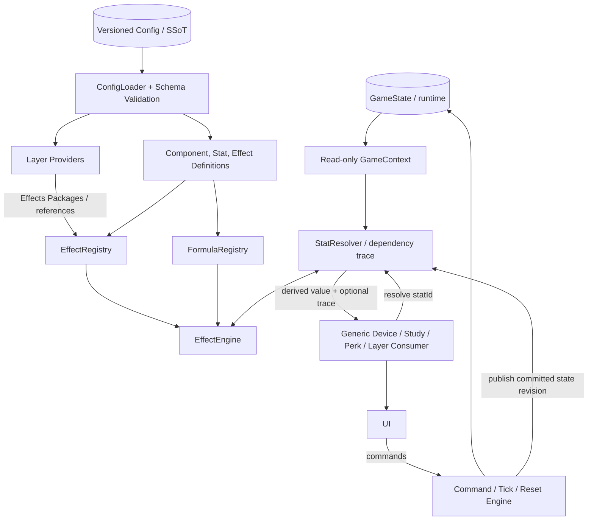
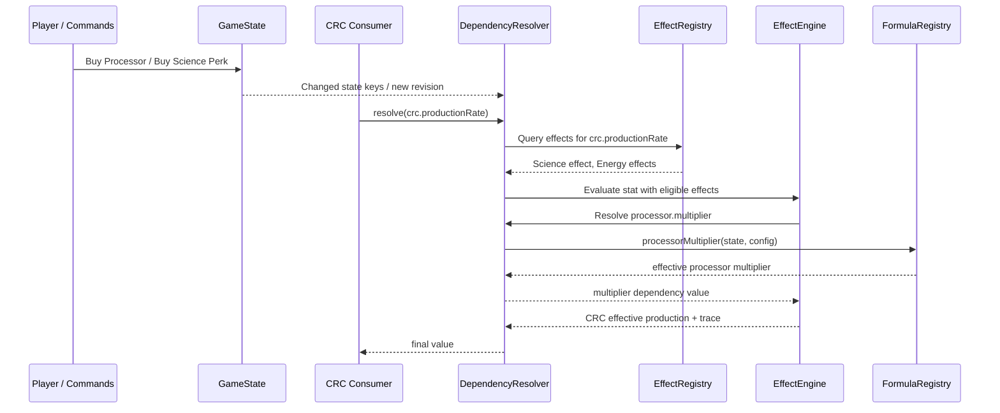

# Historical classes blueprint

> **Archive notice:** This is preserved planning material, not an implementation specification for the public BETA. Verify all mechanics and names against the current source, configuration, and executable tests.

# The Eternal Simulation — Class Model & Relationships

> **Status:** arquitetura de referência v1.1 — proposta para implementação incremental.
> **Público:** contributors, mantenedores e agentes de programação (Copilot/Codex).
> **Documento complementar:** `The_Eternal_Simulation_Architecture_Blueprint.md`.
> **Escopo:** organização de classes, instâncias, contratos, relações entre Layers, componentes e efeitos, e registro das decisões discutidas.
> **Idioma:** explicações em português; identificadores de código em inglês.

## 1. Decisão central

**Não criar uma classe para cada Device, Perk ou Study.** Criar **abstrações reutilizáveis** de componentes, usar **definições declarativas** para o conteúdo e reservar classes específicas para comportamentos que realmente precisam delas.

A arquitetura adota cinco princípios:

1. **Layers organizam o domínio**, não guardam conhecimento direto sobre as demais Layers.
2. **Configuração versionada é a SSoT das regras**; `GameState` é a SSoT da partida; valores derivados são calculados, nunca a verdade persistente.
3. **Effects Packages são produzidos por origem e indexados por destino** em um Registry compartilhado: relação lógica **N:N**, sem referências cruzadas entre Layers.
4. **Consumidores pedem atributos por ID** (`resolve(statId)`); não precisam conhecer a lista de perks que os modificam.
5. **EffectEngine executa operações e composição**; `FormulaRegistry` mantém fórmulas matemáticas particulares; `StatResolver` resolve dependências e gera trace. Cache é uma otimização posterior e descartável.
6. **Runtime reutilizável e conteúdo permanecem separados:** a infraestrutura recebe um `GamePackage`; regras exclusivas do TES continuam no pacote do TES ou em behaviors explícitos.

**Princípio operativo:** *para adicionar um perk convencional, deve bastar declarar dados, associar efeitos a um atributo existente e adicionar testes — sem editar a classe do CRC, Study ou qualquer outro consumidor.*

### 1.1. O que NÃO é a arquitetura

- **Não** é uma malha de imports `ScienceLayer -> EnergyLayer -> ParticlesLayer`.
- **Não** é uma classe por objeto concreto: `class CRC`, `class PowerCell`, `class QuantumSuperpositionPerk` etc. por padrão.
- **Não** é uma `EffectEngine` com um enorme `switch` para decidir o destino de cada perk.
- **Não** é guardar números finais de produção nos JSONs de configuração.
- **Não** é tratar ações como prestige, compras e automação como efeitos aritméticos puros.
- **Não** exige construir um framework genérico para qualquer tipo possível de jogo.

---

## 2. Mapa das relações



**A relação N:N existe nos dados:** qualquer Layer pode publicar efeitos para qualquer `statId`, e cada `statId` pode receber efeitos de diversas Layers. No runtime, essa relação passa pelo `EffectRegistry`; as instâncias de Layers **não** se conhecem diretamente.

### 2.1. Tradução da ideia original do projeto

Proposta discutida:

```text
Science Class -> Effects Package (JSON-like) -> Any Class
Any Class -> requests relevant effects -> Effect Engine
Effect Engine -> computed property -> Any Class
```

Forma arquitetural consolidada:

```text
ScienceLayer -> Effects Package -> EffectRegistry
                                      |
CRC / Any Consumer -> resolve(statId) -> DependencyResolver
                                      |
                              EffectEngine + FormulaRegistry
                                      |
                                 calculated stat
                                      |
CRC / Any Consumer <-----------------+
```

O comportamento desejado se mantém: a Layer publica, o consumidor solicita, a engine calcula. A melhoria é que o consumidor **não seleciona manualmente as chaves de cada fornecedor**; solicita somente o atributo relevante e o Registry encontra todas as contribuições.

---

## 3. Quais classes, interfaces, módulos e dados devem existir?

| Artefato | Forma recomendada | Responsabilidade | Exemplo |
|---|---|---|---|
| `GameEngine` / `GameCoordinator` | Serviço/classe | Inicialização, ciclo de execução e orquestração sem regras específicas de perks | bootstrap, simulação |
| `GameLayer` / `LayerProvider` | Interface + instância/classe opcional | Agrupar definições, registrar conteúdo, coordenar lifecycle quando houver | `ScienceLayer` |
| `DeviceDefinition` | Tipo/interface + config | Identidade, custo, stats, fórmula-base, requisitos | `crc`, `processor` |
| `DeviceInstance` | Classe genérica **opcional** | API de leitura/comandos sobre estado do dispositivo | Device (`id = crc`) |
| `StudyDefinition` | Tipo/interface + config | Definição de estudo e suas regras | `algorithmImprovement` |
| `StudyInstance` | Classe genérica **opcional** | API comum dos estudos | Study (`id = cmu`) |
| `PerkDefinition` | Tipo/interface + config | Custo, dependencies, efeitos, reveal, layout | `quantumSuperposition` |
| `PerkInstance` | Em geral **desnecessária** | O estado de comprado/revelado vive em `GameState` | consulta `perkPurchased(id)` |
| `EffectDefinition` | Tipo/interface + config | Fonte, target, operador, fórmula, condicionais, prioridade | bônus Processor → CRC |
| `EffectRegistry` | Serviço/classe | Indexar efeitos por `targetStatId`, buscar fontes elegíveis | `getByTarget` |
| `EffectEngine` | Serviço/classe | Avaliar expressões, aplicar operações e ordem de composição | `resolve`, `compose` |
| `FormulaRegistry` | Módulo/serviço | Fórmulas puras reutilizáveis por ID | `processorMultiplier` |
| `StatResolver` | Módulo/classe | Resolver stats, detectar ciclos e produzir trace de dependências | `resolve(statId)` |
| `DerivedCache` | Módulo opcional | Evitar recálculos comprovadamente caros sem virar fonte de verdade | cache por snapshot/revision |
| `NumericAdapter` | Módulo profundo | Aritmética BigNum, comparação, serialização e notação | `break_eternity.js` encapsulado |
| `GameState` | Estrutura de dados versionada | Inventário, recursos, perks, descobertas e progresso | `processorsOwned` |
| `CommandEngine` | Serviço/classe | Compras, ticks, resets e outras transições atômicas | `PerformParticleSynthesis` |
| `Behavior` / `System` | Função/módulo/classe quando justificado | Comportamentos stateful ou de ciclo de vida especial | Overclocker, Assembly Line |

**Regra:** "classe" é uma escolha de encapsulamento, não o objetivo. Uma interface TypeScript e uma função pura frequentemente resolvem melhor que uma hierarquia extensa.

### 3.1. Quando justificar uma classe concreta

**Criar classe específica apenas quando pelo menos uma destas condições existir:**

- Ciclo de vida ou comportamento próprio que não cabe na abstração compartilhada (`start`, `stop`, `cooldown`, fila, eventos).
- Estado operacional interno com invariantes relevantes (por exemplo, uma máquina com fases independentes da compra).
- Estratégia especializada substituível que será reutilizada e testada separadamente.
- Colaboração necessária entre métodos com uma interface estável, e não apenas diferenças de parâmetros.

**Preferir configuração + classe genérica** quando a diferença for custo, multiplicador, limite, curva de escala, requisitos, textos, target ou fórmula já registrada.

Exemplos:

- **CRC:** definição de `Device` + `statId` de produção; não precisa de classe exclusiva apenas por produzir energia.
- **Processor:** definição de `Device` + stat derivada de eficiência; não precisa de classe exclusiva.
- **Power Cell:** definição de `Device` + efeito de capacidade; não precisa de classe exclusiva.
- **Algorithm Improvement:** definição de `Study` + progressão e fórmula; sem classe própria inicialmente.
- **Quantum Calculation Principles:** definição de `Perk` que publica um efeito; sem classe própria.
- **Quantum Superposition:** perk declarativo fornece uma taxa de retenção; **um handler do comando de Algorithm Upgrade** implementa a retenção durante o reset. Não é preciso uma classe por perk.
- **Overclocker:** pode ter `OverclockBehavior`/sistema separado por ativação, consumo crescente e cooling.
- **Assembly Line:** pode ter `AssemblySystem`/estado de unidades e filas quando suas operações justificarem um comportamento especializado.

---

## 4. O papel exato de uma Layer

Uma Layer é uma **unidade organizacional e de progressão**. Ela pode publicar definições e políticas próprias, além de implementar hooks de ciclo de vida. Ela **não** precisa possuir instâncias concretas de todos os dispositivos/estudos/perks.

```typescript
interface LayerProvider {
  readonly id: LayerId;
  registerContent(registry: ContentRegistry): void;
  // Hooks opcionais apenas quando a Layer realmente os exige:
  onEnter?(ctx: ReadonlyGameContext): CommandIntent[];
  onPrestige?(ctx: ReadonlyGameContext): CommandIntent[];
}
```

Possível implementação:

```typescript
class ScienceLayer implements LayerProvider {
  readonly id = "science" as const;

  registerContent(registry: ContentRegistry): void {
    registry.registerLayerContent(this.id);
  }
}
```

**Observação:** o exemplo mostra um contrato, não APIs existentes no repositório. `registry.registerLayerContent` representaria uma função de carregamento das definições já validadas; pode ser substituída por providers estáticos.

A Layer fornece seu **Effects Package** com referências a definições/ativadores, não um grande objeto com multiplicadores finais congelados. Isso impede valores obsoletos após compras e resets.

```typescript
interface EffectsPackage {
  sourceLayer: LayerId;
  effectIds: readonly EffectId[];
}
```

Se o contrato exigir pacotes contendo as definições completas, podem ser indexadas em vez das IDs — contanto que provenham da mesma SSoT e sejam imutáveis por versão.

### 4.1. Relação Layer × componente

- **Pertencimento lógico:** CRC pertence ao conteúdo de Energy; Quantum Superposition pertence a Science.
- **Identidade de estado:** progresso armazenado em `GameState`, por ID estável, não dentro de instâncias que seriam recriadas no reload.
- **Dependência de cálculo:** a produção do CRC pode depender de uma stat exposta por Science/Particles sem importar essas Layers.
- **Acesso cruzado:** somente através de `GameContext`, `resolve(statId)` e comandos.

---

## 5. As três verdades: configuração, partida, derivação

### 5.1. `Config`: SSoT de definições

Armazena coeficientes, IDs, catálogos, fórmulas por ID, tipos de efeito, fases de composição, requisitos e metadados. É editável/versionado e validado por schema.

```json
{
  "schemaVersion": 1,
  "devices": {
    "crc": { "baseProduction": "1e-12" },
    "processor": { "baseEfficiency": "1.15" }
  },
  "stats": {
    "devices.processor.multiplier": {
      "formulaId": "processorMultiplier",
      "unit": "multiplier"
    },
    "devices.crc.productionRate": {
      "formulaId": "crcBaseProduction",
      "unit": "J/s",
      "compositionPolicy": "productionDefault"
    }
  },
  "effects": [
    {
      "id": "science.processorBonusToCrc",
      "sourceLayer": "science",
      "targetStatId": "devices.crc.productionRate",
      "type": "mult",
      "formulaId": "processorBonusPower",
      "params": { "exponent": "0.15" },
      "enabledWhen": { "perkPurchased": "science.processorBonusToCrc" }
    }
  ]
}
```

Os nomes de IDs são **exemplificativos**; devem ser alinhados à base existente durante a migração. Não armazenar código executável livre dentro de JSON.

### 5.2. `GameState`: SSoT da partida

Ex.: `crcsOwned`, `processorsOwned`, `storedEnergy`, `algorithmImprovements`, `totalQuarksEarned`, `purchasedPerks`, `discoveredPerks`.

**Não** persistir `crc.finalProductionRate` como fonte de verdade. Após carregar save ou atualizar parâmetros, recalcular valores derivados.

### 5.3. `Derived State`: resultado calculado

Ex.: `devices.processor.multiplier`, `devices.crc.productionRate`, `studies.algorithmUpgrade.speed`. Pode ficar em cache **descartável**.

**Relação de dependências:**

```text
config.processor.baseEfficiency + state.processorsOwned
   -> devices.processor.multiplier
      -> science.processorBonusToCrc effect factor (if purchased)
         -> devices.crc.productionRate
            -> stored energy increment per tick
```

Um `config.json` elimina duplicação de parâmetros, **mas não substitui** a invalidação de cache quando `processorsOwned` muda.

---

## 6. EffectDefinition, Registry, Engine e FormulaRegistry

### 6.1. Quem conhece o destino do efeito?

**A definição de efeito conhece seu `targetStatId`; o Registry indexa; a Engine calcula.**

- `EffectDefinition` declara **o que afeta o quê**.
- `EffectRegistry` mantém `Map<StatId, EffectDefinition[]>` e outras consultas eficientes.
- `EffectEngine` implementa operações genéricas, condições, ordem de composição e trace.
- `FormulaRegistry` implementa equações especializadas (`quantumRetention`, `crcBaseProduction`, `processorMultiplier` etc.).
- A **classe consumidora não escolhe manualmente os perks que a afetam**; solicita uma stat.

### 6.2. Contrato de dados — exemplo simplificado

```typescript
type StatId = string;
type EffectId = string;
type LayerId = string;
type FormulaId = string;

type EffectOperation =
  | "add" | "multiply" | "power" | "log"
  | "softcap" | "hardcap" | "floor" | "override";

type StepSemantics =
  | "none" | "compoundRate" | "repeatTransform" | "customFormula";

interface EffectDefinition {
  id: EffectId;
  sourceLayer: LayerId;
  targetStatId: StatId;
  operation: EffectOperation;
  stepSemantics: StepSemantics;
  formulaId?: FormulaId;
  params?: Readonly<Record<string, string>>;
  stepSource?: string;
  enabledWhen?: unknown; // usar AST/condition schema validado
  priority?: number;
}
```

O `number` nativo do JavaScript não é o tipo numérico universal do jogo. Campos numéricos no JSON podem utilizar strings para suportar números grandes e preservar exatidão dentro do adaptador escolhido.

### 6.3. Responsabilidade da `EffectEngine`

```typescript
interface EffectEngine {
  resolve(statId: StatId, ctx: ReadonlyGameContext): BigNum;
  explain(statId: StatId, ctx: ReadonlyGameContext): EffectTrace;
}
```

A `EffectEngine` deve **descobrir efeitos por Registry**, solicitar dependências ao Resolver, processar expressões pelo FormulaRegistry e aplicar a política de composição daquela stat.

**Não colocar na Engine:**

```typescript
if (science.hasPerk("processor-to-crc")) {
  // apply bonus specifically to CRC
}
```

Isso pertence à definição declarativa do efeito, sob `enabledWhen` e `targetStatId`.

### 6.4. Onde alterar parâmetros e fórmulas?

| Alteração desejada | Local |
|---|---|
| Trocar eficiência base de Processor `1.15 -> 1.18` | Config |
| Trocar potência aplicada ao bônus `0.15 -> 0.20` | Config |
| Fazer perk existente atingir mais uma stat | Adicionar declaração de efeito com novo `targetStatId` na Config |
| Criar perk com operações existentes | Config + testes |
| Alterar fórmula de retenção de Quarks | `FormulaRegistry` + parâmetros na Config |
| Alterar semântica de `mult` em todos os efeitos | `EffectEngine` + testes de contrato |
| Alterar fórmula base do CRC | Fórmula específica do domínio/`FormulaRegistry` + testes |

**Importante:** centralizar cálculo não significa concentrar toda equação de domínio em uma única God Class.

---

## 7. Tipos de efeito e concatenação

O Architecture Blueprint principal detalha a semântica. Esta seção registra as consequências para o modelo de classes.

### 7.1. Aliases acordados (com uma normalização pendente)

| Alias | Uso | Interpretação de referência |
|---|---|---|
| `mult` | Multiplicador direto | multiplicar resultado por fator |
| `expps` | Exponencial direto | elevar valor a uma potência |
| `logg` | Logarítmico direto | aplicar log explicitamente configurado |
| `mults` | Multiplicador por step | fator por evolução, normalmente `(1+rate)^steps` |
| `expps_step` | Exponencial por step | potência repetida ou fórmula de steps declarada |
| `loggs` | Logarítmico por step | iteração de log ou fórmula de steps declarada |

**Nota:** o termo `expps` havia sido usado para o tipo direto e o tipo por step. `expps_step` é uma **proposta de desambiguação**, ainda sujeita a confirmação. Os seis aliases são sintaxe de conteúdo sobre `operation + stepSemantics`, **não seis classes**.

Operadores que recomendarmos adicionar conforme uso: `add`, `adds`, `softcap`, `hardcap`, `floor`, `override`. A ativação de automação ou unlock é regra/ação, não multiplicador.

### 7.2. Composição é responsabilidade compartilhada pela infraestrutura

- **Definição da stat / Config:** escolhe a política de composição e as exceções.
- **EffectRegistry:** reúne contribuições elegíveis por target.
- **EffectEngine:** ordena e aplica a composição deterministicamente.
- **Layer consumidora:** solicita `resolve(statId)` e utiliza o valor; **não reimplementa a concatenação**.

Ordem padrão **proposta**, personalizável por stat: `base -> add -> multiply -> power -> log -> softcap/hardcap/floor -> override` (com precedência de `override` declarada). Potências e logs **não comutam**; a posição de cada efeito deve estar definida, não depender da ordem dos arquivos.

**Atenção:** `processor.multiplier ^ 0.15` é normalmente **a expressão de um fator multiplicador** da produção do CRC, e não uma potência aplicada à produção final. O contrato precisa distinguir a operação sobre o acumulador da fórmula que fornece seu argumento.

### 7.3. Por step não significa por tick

Um efeito composto por A. Improvement pode gerar `(1 + rate)^improvementsOwned`. A quantidade de steps deve referenciar um contador explícito no `GameState`/stat derivada. Não presumir que `steps == deltaTime`; softcaps e hardcaps pertencem à definição da fórmula.

Para quantidades gigantes, evitar repetir um loop milhões de vezes. Preferir fórmulas fechadas, estratégias numéricas seguras ou rejeitar configurações sem cálculo viável.

---

## 8. StatResolver desde o início; cache após evidência

**Decisão corrigida:** resolução por ID, detecção de ciclos e trace de dependências fazem parte da fundação. Cache seletivo não. Para a escala atual do TES, recalcular fórmulas puras é mais simples e menos arriscado do que manter invalidação granular sem medição que a justifique.

### 8.1. Grafo de leitura

Quando `resolve("devices.crc.productionRate")` consulta `resolve("devices.processor.multiplier")`, o sistema registra que a primeira stat **depende** da segunda.

Também é preciso rastrear leituras de `GameState` e da Config:

```text
state.processorsOwned ----------------------+
config.devices.processor.baseEfficiency ---+-> processor.multiplier
                                               |
state.perks.processorToCRC --------------------->|-> crc.productionRate
config.effects.processorExponent -------------->|
state.crcsOwned -------------------------------->|
```

### 8.2. Políticas obrigatórias do resolver

- Dependências estáticas explícitas quando possíveis; dinâmicas capturadas pelas leituras via `GameContext`.
- `resolve()` é puro: não muta `GameState`, não executa compras, não dispara efeitos colaterais.
- Detectar ciclos de stats com *resolution stack* e reportar o caminho completo.
- Produzir trace suficiente para explicar origem, fórmula, operação e valor final.
- Recalcular a partir do snapshot corrente; derived state nunca é persistido como verdade.
- Atualizar dependências se uma condição muda o ramo lido (efeitos condicionais).
- Não reutilizar resultados entre configurações ou snapshots diferentes sem chave de revisão explícita.
- Primeiro priorizar correção; otimizações avançadas vêm após profiling.

### 8.3. Como implementar incrementalmente

1. **Versão inicial:** resolver puro, stack de detecção de ciclos, dependências explícitas e trace.
2. **Após profiling:** cache por snapshot/revision apenas nas stats com custo ou frequência relevantes.
3. **Somente se necessário:** invalidação seletiva transitiva por stat, com benchmark e teste de equivalência cache on/off.

Isso preserva a rastreabilidade desde o início sem fazer a correção do jogo depender de uma otimização especulativa.

---

## 9. Mutação de estado, ticks e resets: fora da aritmética

Um efeito puro retorna **uma propriedade derivada**. Eventos que mudam a partida passam por comandos.

```text
UI / Automation -> CommandEngine
  -> validate purchase / tick / prestige
  -> resolve effective stats and modifiers
  -> compute next state transactionally
  -> commit state + version
  -> invalidate affected cache entries
```

Exemplo específico: **Quantum Superposition**.

- O perk é uma `PerkDefinition` declarativa.
- Um efeito fornece `studies.algorithmUpgrade.retentionFraction` com base em `totalQuarksEarned`.
- O comando `PerformAlgorithmUpgrade` solicita essa stat, aplica a retenção ao *novo estado* e confirma a transação.
- A `EffectEngine` **não reseta Improvements**, apenas calcula a taxa. Não há uma `class QuantumSuperpositionPerk` obrigatória.

Exemplo específico: **Overclocker**.

- Possui definição de Device na configuração.
- Um `OverclockBehavior`/sistema opera ativação, cooling e consumo por tick.
- Seus modificadores contínuos podem usar a mesma EffectEngine.

**Regra:** event hooks, transações e fórmulas não podem produzir duas fontes contraditórias de verdade.

---

## 10. Exemplo ponta a ponta: Science afeta CRC sem importar Energy

### Situação

- Processor possui eficiência base `1.15` por unidade.
- Science Perk comprado habilita uma contribuição sobre `devices.crc.productionRate`.
- A expressão do fator é `devices.processor.multiplier ^ 0.15`.
- A fórmula base e os estudos existentes do CRC permanecem no domínio Energy.

### Caminho real de execução



**Alterar um valor:** trocar `processor.baseEfficiency` na Config faz todos os consumidores da stat `processor.multiplier` observarem o novo valor após invalidação de dependências.

**Adicionar um efeito:** um futuro perk de Particles declara novo `targetStatId = devices.crc.productionRate`. Nenhum código de `CRC`, `EnergyLayer` ou `ScienceLayer` precisa ser editado para receber o efeito, se a stat e os operadores já existem.

**Adicionar novo atributo:** se o CRC passar a ter `radiationAbsorption`, registrar a stat e fazer o consumidor solicitá-la; não há como a Engine descobrir automaticamente uma propriedade completamente inédita sem sua definição e consumo.

---

## 11. Estrutura sugerida de diretórios

```text
src/
  config/
    devices.json
    studies.json
    perks.json
    stats.json
    effects.json
    schema/
  core/
    GameEngine.ts
    GameContext.ts
    numeric/
      BigNumAdapter.ts
    state/
      GameState.ts
      SaveMigrator.ts
    content/
      ContentRegistry.ts
      ConfigLoader.ts
    effects/
      EffectTypes.ts
      EffectRegistry.ts
      EffectEngine.ts
      CompositionPolicy.ts
      FormulaRegistry.ts
    dependencies/
      DependencyGraph.ts
      DependencyResolver.ts
      Cache.ts
    commands/
      CommandEngine.ts
      ResetEngine.ts
      TickEngine.ts
  components/
    Device.ts             # classe genérica, se útil
    Study.ts              # classe genérica, se útil
    definitions.ts        # tipos para Device/Study/Perk
  layers/
    energy/
      EnergyLayer.ts
      definitions.ts
      formulas.ts
      behaviors/
        OverclockBehavior.ts
    science/
      ScienceLayer.ts
      definitions.ts
      formulas.ts
    particles/
      ParticlesLayer.ts
      definitions.ts
  ui/
    components/
    views/
  tests/
    contracts/
    effects/
    integration/
    dependency-cache/
    migration/
    progression/
docs/
  ARCHITECTURE.md
  CLASS_MODEL_AND_RELATIONSHIPS.md
  ADR/
```

**Não criar a árvore completa de pastas antecipadamente.** Adequar à stack e ao repositório reais; o desenho é lógico, não um mandato de nomenclatura.

---

## 12. Processo de raciocínio: como chegamos à arquitetura

Esta seção registra **as etapas e justificativas explicitamente discutidas no planejamento**, e não uma transcrição de processos internos de pensamento. Serve para explicar aos futuros contributors **por que** as decisões existem e quais alternativas foram consideradas.

### Etapa 1 — Problema: uma fórmula produz impactos em cascata

**Observação inicial:** mudar a eficiência do Processor alteraria Calculator Speed, CRC Production via perk, automações, duração das runs e economia de SP. Editar manualmente cada consequência seria frágil.

**Conclusão:** precisamos de referências compartilhadas a atributos calculáveis e da propagação automática dos valores, em vez de resultados duplicados ou códigos de atualização em cada classe.

### Etapa 2 — Primeira alternativa: classes para Layers e componentes

**Hipótese:** organizar o jogo por `EnergyLayer`, `ScienceLayer`, `ParticlesLayer` e classes de Device, Study e Perk.

**Risco identificado:** uma classe específica por CRC, Processor, Power Cell e cada perk geraria muitas classes triviais. A herança não resolveria automaticamente os efeitos cruzados.

**Decisão:** Layers podem ser classes ou providers; Device/Study/Perk serão principalmente **tipos genéricos e definições de dados**. Classes especializadas só quando existir comportamento independente relevante.

### Etapa 3 — Proposta de Effects como objetos reutilizáveis

**Hipótese:** representar modificadores por objetos `Effect` que indiquem sobre o que atuam.

**Ajuste:** usar `statId`/`targetStatId` em vez de referências diretas a objetos concretos. Com IDs estáveis, a origem não precisa importar a implementação do destino.

**Decisão:** contrato padronizado de efeitos e Registry por atributo.

### Etapa 4 — Ideia N:N com Effects Packages por Layer

**Proposta do design:** `Class Science -> [Effects Package JSON] -> Class Any`; o consumidor selecionaria dados relevantes e invocaria métodos de uma Effects Class.

**Ponto forte reconhecido:** separar produção de modificadores (origem), cálculo (motor compartilhado) e consumo (atributo final). Permite novas eras sem criar uma hierarquia rígida.

**Aprimoramento:** preservar os pacotes agrupados por Layer, mas criar um `EffectRegistry` intermediário. Assim o consumidor consulta `resolve(statId)` e não precisa ser atualizado sempre que uma nova Layer passar a afetá-lo.

**Decisão:** **N:N lógico via pacotes + registro central de destinos.**

### Etapa 5 — SSoT externa para eliminar valores hardcoded

**Proposta:** parâmetros, custos e definições em `config.json` ou equivalente.

**Benefício:** alterar `1.15` ou `0.15` uma única vez e manter todas as instâncias coerentes.

**Limite reconhecido:** configuração compartilhada não invalida automaticamente resultados já calculados e armazenados em memória. A SSoT das regras e a SSoT da partida são entidades diferentes.

**Decisão:** Config versionada + GameState separado + derived values reconstruíveis.

### Etapa 6 — Onde morarão fórmulas e concatenação?

**Hipótese:** centralizar tudo em `EffectEngine` e deixar cada Layer consumidora concatenar seus efeitos.

**Risco:** regras de composição divergentes entre Layers e `EffectEngine` transformada numa classe gigantesca com conhecimento de todas as mecânicas.

**Decisão:** `EffectEngine` padroniza execução/concatenação; `FormulaRegistry` guarda equações especializadas; `Config` define operadores, parâmetros, pipelines e targets. O consumidor solicita apenas a stat.

### Etapa 7 — Seis tipos de efeitos e escalonamento por step

**Proposta:** `mult`, `expps`, `logg` e variantes por evolução: `mults`, `expps` e `loggs`.

**Ambiguidade detectada:** `expps` tinha dois significados. O blueprint propôs o identificador provisório `expps_step` para potência por evolução.

**Decisão:** manter aliases de design, mas normalizar no núcleo como **operação + semântica de step**. Acrescentar `add`, caps e override quando necessários, sem inflar a árvore de classes.

### Etapa 8 — Dependências desde o começo; cache após profiling

**Proposta:** já nascer com rastreamento e cache, em vez de adicionar numa refatoração futura.

**Benefício esperado:** propagação previsível, cálculos eficientes e rastreabilidade de impactos.

**Contraponto:** números enormes não tornam uma fórmula automaticamente cara; `BigNum` e fórmulas fechadas continuam baratos em escalas usuais. Cache sofisticado com invalidação incorreta é pior que recalcular.

**Decisão:** resolver, trace e detecção de ciclos desde a fundação. Adicionar cache por snapshot apenas após profiling; invalidação seletiva somente se esse cache realmente existir.

### Etapa 9 — Resultado arquitetural consolidado

**Componentes possuem definições e estado. Layers organizam conteúdo. Efeitos declarativos conectam origens e destinos. Registry descobre contribuições. EffectEngine combina. FormulaRegistry calcula equações específicas. StatResolver garante resolução e rastreabilidade. Commands mutam o jogo.**

O ganho não é "nunca mais editar código"; é **reduzir mudanças locais e torná-las previsíveis**, com testes que evidenciem impactos de balanceamento.

---

## 13. Guia operacional para contributors e agentes de IA

### 13.1. Para adicionar um Device

1. Declarar `DeviceDefinition`, seus custos, requisitos e estado necessário.
2. Registrar stats próprias e fórmulas base, com unidades.
3. Declarar quaisquer efeitos emitidos e seus `targetStatId`s.
4. Reutilizar a API genérica de Device e comandos comuns.
5. Criar behavior separado apenas se houver ações especiais/ciclo de vida específico.
6. Testar cálculos, saves, compras e invalidação de cache.

### 13.2. Para adicionar um Study

1. Criar definição de Study e seus `stepSource`, requisitos e reset rules.
2. Apontar efeitos para stats existentes por IDs.
3. Implementar novas fórmulas **apenas** se não forem expressáveis pelos operadores existentes.
4. Testar steps, limites e efeitos ao fazer prestige/reset.

### 13.3. Para adicionar um Perk

1. Definir ID estável, custo, branch, requisitos, revelação e efeitos na Config.
2. Declarar cada target e operação; não editar consumidores existentes.
3. Se o perk altera uma transação (ex.: preservação no reset), registrar uma stat ou política consultada pelo Command correspondente.
4. Testar estado comprado/não comprado, tooltip/reveal, efeitos, cache e compatibilidade com saves.

### 13.4. Para adicionar uma Layer

1. Criar provider e definições segundo os mesmos contratos existentes.
2. Registrar pacotes por origem e respectivos targets; evitar imports diretos de outras Layers.
3. Implementar hooks/transações apenas quando a mecânica exigir.
4. Garantir que fontes e consumidores existentes não precisem de mudanças para receber efeitos sobre stats já registradas.
5. Testar efeitos cruzados, resets e simulação headless.

### 13.5. Para mudar uma equação

1. Identificar se a mudança é **parâmetro**, **fórmula específica** ou **semântica universal de operação**.
2. Editar respectivamente Config, FormulaRegistry ou EffectEngine.
3. Validar domínios, unidades, grandes números e prioridades.
4. Executar testes numéricos e integração com cache ligado/desligado.
5. Comparar evolução de runs usando SimulationRunner; registrar impactos relevantes.

### 13.6. Proibições arquiteturais

- Não criar classe específica por perk/dispositivo sem justificativa registrada.
- Não adicionar imports diretos entre Layers para buscar bônus de outras eras.
- Não editar CRC/Study apenas para que reconheça novo perk que aponta a stat existente.
- Não manter a mesma constante numérica hardcoded em locais diferentes.
- Não armazenar valores derivados como fonte de verdade persistente.
- Não executar `eval`, código arbitrário oriundo de JSON ou efeitos colaterais durante `resolve()`.
- Não corrigir silenciosamente uma dependência de jogo ambígua; documentar ADR.
- Não alterar regras de gameplay durante refatoração arquitetural sem teste de equivalência e autorização.

---

## 14. Testes de arquitetura que demonstram o objetivo

| Cenário | Critério de aprovação |
|---|---|
| Processor muda de `1.15` para `1.18` na Config | Todas as stats dependentes mudam após invalidação; nenhuma duplicação de coeficiente |
| Novo efeito de Particles aponta ao CRC | CRC recebe novo bônus sem mudança em sua classe ou na EnergyLayer |
| Um perk fica inativo após reset | Resultado reverte corretamente, cache não reutiliza bônus anterior |
| Efeito encadeado lê outra stat | Resolver calcula ordem correta, registra dependências e faz trace |
| Duas stats dependem circularmente | Erro diagnosticável com caminho do ciclo; nenhum loop infinito |
| 10 milhões de steps | `mults`/`expps_step` não iteram ingenuamente milhões de vezes |
| Cache ativado ou desativado | Resultado equivalente para as mesmas snapshots |
| `Quantum Superposition` em Algorithm Upgrade | A taxa é calculada pela Engine; reset é aplicado atomicamente pelo comando |
| Reload de save antigo | Migrador conserva estado e derived values são reconstruídos |
| Nova Layer é registrada | Efeitos tornam-se descobertos pelo Registry sem import cruzado |

---

## 15. Decisões confirmadas, propostas e questões abertas

### Confirmadas como direção do design

- Relações **N:N por Effects Packages** entre Layers e atributos consumidores.
- Uma **SSoT externa** para definições e parâmetros, distinta do estado da partida.
- Distribuição/cálculo compartilhados em **Registry + EffectEngine**.
- Efeitos solicitados por **IDs de atributos**, não por imports cruzados de Layers.
- **Sem classe por Device/Study/Perk** como regra geral.
- Resolução, dependências e detecção de ciclos tratadas **desde a fundação**; cache condicionado a profiling.

### Recomendações arquiteturais consolidadas neste documento

- `FormulaRegistry` separado da `EffectEngine`.
- `StatResolver` com resolução, trace e detecção de ciclos; `DerivedCache` opcional e separado.
- `Device` e `Study` como classes genéricas apenas se o runtime se beneficiar; `Perk` preferencialmente como dados.
- Operadores e semântica de steps são dimensões distintas.
- Comandos transacionais separados de cálculos puros.
- Pipeline de efeitos declarada por atributo, com ordem determinística.

### A confirmar antes da implementação final

1. Stack e organização do **repositório real** (não presumir TypeScript/React).
2. Regras finais de arredondamento por tipo de recurso; a representação já foi decidida como `break_eternity.js` atrás de `NumericAdapter`.
3. Nomenclatura final para `expps_step` e semântica desejada de `loggs`.
4. Política exata de composição em stats específicas que usam potência/log.
5. Granularidade de `statId` para instâncias individuais versus dispositivos agregados.
6. Estratégia de hot reload de config e migração de saves.
7. Regras de progressão ambíguas no conteúdo, como a dependência de Redundancy Elimination.
8. Se e quando um componente realmente precisa de uma classe/behavior específico.

### 15.1. Reuso em outros jogos

O objetivo de "peças de Lego" é atendido por quatro contratos, não por uma hierarquia extensa:

1. **Runtime estável:** `GameEngine`, `CommandEngine`, `StatResolver`, `EffectEngine`, `AvailabilityEngine`, `ResetEngine`, `AutomationScheduler`, `OfflineSimulator`, `SaveManager` e `NumericAdapter`.
2. **GamePackage declarativo:** recursos, Layers, Devices, Studies, Perks, efeitos, resets e layout de progressão.
3. **Runtime State separado:** somente o que pertence à partida e precisa ser salvo.
4. **Behavior plugins:** módulos especializados para casos como Overclocker, sem contaminar a classe genérica `Device`.

Conceitualmente, outro incremental deveria iniciar com `createIncrementalGame(gamePackage, behaviors)`. Entretanto, o runtime deve ser extraído do TES apenas depois que um segundo jogo real provar quais contratos são de fato compartilhados. Até lá, manter as fronteiras reutilizáveis dentro do projeto evita construir um framework baseado em requisitos imaginados.

---

## 16. Critério de sucesso da arquitetura

Um contributor deve conseguir:

1. **Criar um perk novo** usando somente uma definição configurável e testes, quando o comportamento é expressável com operações já existentes.
2. **Alterar um coeficiente** na Config sem buscar todas as referências no código.
3. **Trocar uma equação** em um único handler especializado e testar os consumidores afetados.
4. **Adicionar uma Layer** sem reescrever Layers antigas para fazê-las reconhecer novos efeitos.
5. **Explicar um valor final** por um breakdown de efeitos, fórmulas e dependências.
6. **Simular a progressão** com cache e sem cache, obtendo os mesmos resultados.

**Resumo em uma frase:** *não criamos uma classe para cada objeto do jogo; criamos uma infraestrutura de contratos, definições e comportamentos reutilizáveis na qual novos objetos são dados, e novos relacionamentos são efeitos registrados por ID.*
